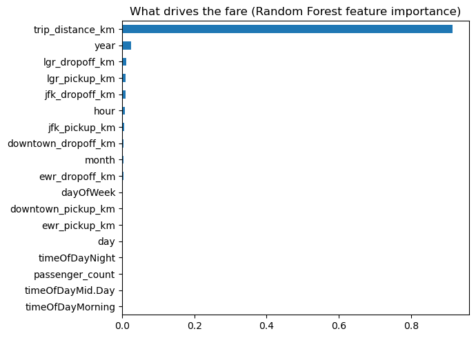
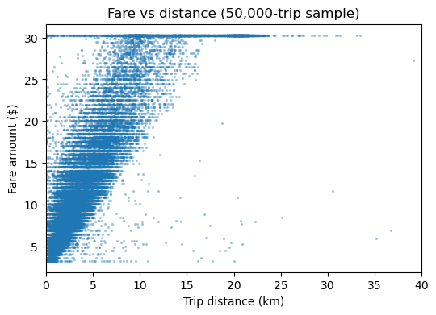

# 🚕 NYC Taxi Fare Prediction

Predicts the fare of a New York City taxi trip **before it starts**, from the pickup and dropoff locations, the pickup time and the number of passengers. Ride-hailing companies solve this same pricing problem at scale.

This is a **regression** project, built end to end: notebook → FastAPI → Streamlit → Docker → GitHub Actions CI/CD → AWS → Databricks.

---

## Results

The models were tested on **103,315 trips they never saw during training**.

| Model | Average error (MAE) | RMSE | R² |
|---|---|---|---|
| Always guess the average fare (baseline) | $5.04 | $6.78 | 0.00 |
| Linear regression | $2.51 | $4.08 | 0.64 |
| **Random Forest (deployed)** | **$1.45** | **$2.42** | **0.87** |

**In plain terms:** the Random Forest prices a trip to within about **$1.45** on average. That's **71% lower** than guessing the average fare, and it explains **87%** of the variation in fares.

---

## What drives the fare



- **Trip distance** accounts for about 90% of the model's decisions, which is what you'd expect for metered taxi fares.
- **Year** comes second, because fares rose over 2009 to 2015.
- **Distance to LaGuardia and JFK airports** helps the model pick up airport trip patterns.
- Passenger count and time of day barely matter. That matches how NYC taxis are priced: the fare doesn't change with the number of passengers.



---

## Approach

**1. Cleaning (1,048,575 → 1,033,148 trips)**
- Removed trips with GPS points outside the New York area
- Removed impossible fares and trips where the pickup and dropoff are the same point
- Kept trips with 1 to 6 passengers

**2. Feature engineering**
- **Trip distance in km** using the **Haversine formula**, which gives the real distance over the Earth's surface. Raw differences in latitude and longitude aren't a true distance, because one degree of longitude covers a different distance depending on latitude.
- **Distance to landmarks:** downtown Manhattan and the JFK, LaGuardia and Newark airports, for both pickup and dropoff
- Date and time features: year, month, day, weekday, hour and time-of-day buckets

**3. Modelling**
- Compared a mean baseline, linear regression and a Random Forest. My original neural network is kept in the notebook as an optional comparison.
- The Random Forest settings (`100 trees, max_depth=15, min_samples_leaf=20`) balance accuracy against file size, so the saved model is about 30 MB and fits within GitHub's limits.

**4. Deployment-ready pipeline**
- Feature building and the model are saved together as **one scikit-learn `Pipeline`** (`taxi_pipeline.joblib`), so the API takes a raw trip in and returns a fare.
- `taxi_features.py` holds the feature code, shared by the notebook, the API and the app, so features are built the same way everywhere.

---

## Known limitations

- **Fares in this dataset only go up to about $30** ($3.30 to $30.27), so expensive trips such as airport flat fares were removed before I received the data. The model **can't predict fares above about $30**. For example, Times Square to JFK is predicted at about $30, below the real flat fare.
- The training file has exactly 1,048,575 rows, which is Excel's row limit. It's a **sample** of the original NYC data, not the full dataset.
- The trips are from **2009 to 2015**. Current NYC fares are higher, so the model would need retraining on recent data to be used today.

---

## Repository contents

| File | What it is |
|---|---|
| `taxi_fare_prediction.ipynb` | Full analysis: cleaning, features, models, comparison, saving |
| `taxi_features.py` | Shared feature code (Haversine distances, date handling) |
| `taxi_pipeline.joblib` | Trained pipeline (features + Random Forest) |
| `taxi_config.json` | Input columns, valid ranges, metrics and the scikit-learn version |
| `train_fare.csv` / `test_fare.csv` | Training data and test trips |
| `predictions.csv` | Predicted fares for the 9,914 test trips |
| `images/` | Charts used in this README |

---

## Run it yourself

```bash
git clone https://github.com/Ugoddy/Taxi-Fare-Prediction.git
cd Taxi-Fare-Prediction
pip install pandas numpy scikit-learn==1.7.2 matplotlib joblib jupyter
jupyter notebook taxi_fare_prediction.ipynb
```

Price a single trip with the saved model:

```python
import joblib
from taxi_features import trip_to_row

model = joblib.load("taxi_pipeline.joblib")
trip = trip_to_row(pickup_lon=-73.9855, pickup_lat=40.7580,      # Times Square
                   dropoff_lon=-73.9772, dropoff_lat=40.7527,    # Grand Central area
                   passenger_count=1, pickup_datetime="2013-03-05T09:30:00")
print(f"Predicted fare: ${model.predict(trip)[0]:.2f}")          # about $7.00
```

> Load the model with **scikit-learn 1.7.2**, the version it was trained with.

---

## Roadmap

- [x] Notebook: cleaning, features, model comparison, saved pipeline
- [ ] FastAPI prediction service
- [ ] Streamlit web app
- [ ] Docker container
- [ ] CI/CD with GitHub Actions (tests + Docker build)
- [ ] Deployment on AWS
- [ ] Databricks

---

## Tech stack

Python · pandas · NumPy · scikit-learn · Matplotlib · Jupyter. Next: FastAPI · Streamlit · Docker · GitHub Actions · AWS · Databricks

## Related project

[Customer Churn Prediction](https://github.com/Ugoddy/Customer-Churn-Prediction): an end-to-end classification project following the same pipeline.
